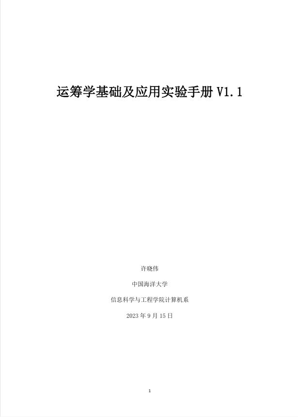

# 运筹学基础及应用实验手册

 

 
我的第一个仓库。

[在线阅读实验手册](./"D:\HuaweiMoveData\Users\86178\Desktop\运筹学基础及应用-实验手册20231229.pdf")
这是我的运筹学课程报告，主要记录课程实验资料，代码示例和笔记学习

## 📚 仓库内容

- 运筹学基础及应用实验手册
- 线性规划问题
- 整数规划问题
- 最短路径问题实验
- 实验过程与结果记录

## 🎯 学习目标

通过本仓库学习和实践一下内容：

- 理解运筹学中的基本概念
- 掌握线性规划模型的建立与求解
- 学习使用计算机工具解决实际问题
- 提高分析问题和编写实验报告的能力

  ## 🛠️ 使用工具

- Python
- Jupyter Notebook
- NumPy
- SciPy
- Matplotlib

 ## 📁 目录结构

```text
.
├── README.md
├── 运筹学基础及应用实验手册.pdf
├── examples/       # 实验代码
├── data/           # 实验数据
└── notes/          # 学习笔记

笔记
🚀 后续计划
- [x] 整理线性规划代码
- [ ] 增加 Python 实验示例
- [ ] 添加实验结果截图
- [ ] 完善课程学习笔记
- [ ] 总结常用算法和解题方法
👤 作者
GitHub: vtri43663-droid
这是我的第一个 GitHub 学习仓库，欢迎交流和提出建议。
